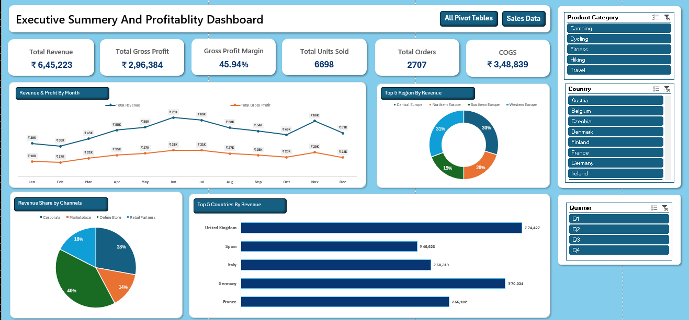

# 📊 Excel Sales & Profitability Dashboard

An end-to-end Excel analytics project: from a raw 2,707-row sales table to an interactive executive dashboard built with Excel Tables, PivotTables, PivotCharts and Slicers.



---

## 🎯 Project Overview

A sales team needs to answer a few questions quickly: *How much are we selling? How profitable is it? Where, through which channel and in which product category does the money come from?*

This dashboard turns one year of order-level sales data (17 European countries, 4 regions, 4 sales channels, 5 product categories) into a single, filterable view that answers those questions in seconds.

**Dataset:** Sample retail sales dataset covering Jan–Dec 2026, 2,707 orders, 25 columns. *(Add source / credit here. This is sample data, not real company data.)*

---

## 📌 Headline KPIs

| Metric | Value |
|---|---|
| **Total Revenue** | €645,223 |
| **Total Gross Profit** | €296,384 |
| **Gross Profit Margin** | 45.94% |
| **COGS** | €348,839 |
| **Total Orders** | 2,707 |
| **Total Units Sold** | 6,698 |
| **Average Revenue per Order** | ≈ €238 |

---

## 🔍 Key Insights

**Geography**
- Western Europe (31%) and Central Europe (30%) together generate over 60% of revenue.
- The **top 5 countries**: United Kingdom, Germany, France, Italy and Spain, contribute about **46%** of total revenue. The UK (€74.4K) and Germany (€70.0K) lead.

**Channels**
- The **Online Store** is the largest channel at ~40% of revenue (€260K), followed by Corporate (28%), Retail Partners (17%) and Marketplace (14%).
- **Corporate has the lowest margin (42.1%)** against roughly 47% for every other channel, which points to heavier discounting on bulk orders.

**Products**
- **Camping** is the biggest category by revenue (€198.5K, 31%) but has the **lowest margin (42.8%)**.
- **Fitness** is the smallest category (€55.6K) but has the **highest margin (51.2%)**, followed by Cycling (48.9%).
- Top products by revenue: Summit Backpack 45L, Alpine Tent 4P, Trail Tent 2P, Trail Boots.

**Seasonality**
- Revenue climbs from a Q1 low (€119K) to a Q2 peak (€182K). **June is the strongest month (€69.5K)**, with a second spike in November (€65.5K). February is the weakest (€35.6K).

**Discounting**
- 56% of orders carry a discount, and margin falls steadily as discounts deepen: **~49.6% at 0% off → ~38.7% at 20% off**.

---

## 💡 Recommendations

1. **Review Corporate pricing.** Cap or tier bulk discounts to protect the channel's 42% margin.
2. **Re-price or re-cost Camping.** It drives the most revenue but earns the least per euro sold.
3. **Grow high-margin categories** (Fitness, Cycling) through bundles and cross-sells with Camping and Hiking orders.
4. **Plan inventory and campaigns around the June and November peaks**, and test promotions to lift the Q1 trough.
5. **Set discount guardrails**: most discount levels are used frequently, but each step costs about 3–4 margin points.

---

## 🧰 Tools & Excel Skills Demonstrated

| Area | What was used |
|---|---|
| **Data modelling** | Excel Tables (structured references) |
| **Calculated columns** | `IFS`, `TEXT`, `YEAR`, `MONTH`, `DAY`, `ROUNDUP`, `IFERROR` for date parts, quarter, Revenue, COGS, Gross Profit and Gross Margin % |
| **Analysis** | 10 PivotTables, including Gross Profit Margin as a calculated measure |
| **Visualisation** | 4 PivotCharts (line, bar, pie, doughnut) |
| **Interactivity** | 3 Slicers: Product Category, Country, Quarter |
| **Dashboard design** | KPI cards, consistent layout, colour theme, navigation buttons |

**Business logic used in the data table**

```
Revenue      = Units Sold × Unit Price × (1 − Discount %)
COGS         = Units Sold × Unit Cost
Gross Profit = Revenue − COGS
Gross Margin = Gross Profit ÷ Revenue
```

---

## 🗂️ Workbook Structure

| Sheet | Purpose |
|---|---|
| **Dashboard** | The interactive executive dashboard (KPI cards, 4 charts, 3 slicers) |
| **Pivot Tables** | All 10 PivotTables that power the KPIs and charts |
| **Data** | Cleaned sales table (`SalesDataTable`, 2,707 rows × 25 columns) |

---

## 🚀 How to Use

1. Download `Excel_Sales_Dashboard.xlsx` from this repository.
2. Open it in **Microsoft Excel (2016 or later; Microsoft 365 recommended)**, since the file uses the `IFS` function and slicers.
3. Go to the **Dashboard** sheet and click the slicers (Product Category, Country, Quarter) to filter the view.
4. Use **Data → Refresh All** after editing the Data sheet to update the pivots.

> Opening the file in Google Sheets or LibreOffice may break slicers and PivotCharts.

---

## 📁 Repository Structure

```
├── Excel_Sales_Dashboard.xlsx   # Final workbook
├── images/
│   └── dashboard.png            # Dashboard screenshot
└── README.md
```

---

## 👤 Author

**Harshit Saini**
B.Tech CSE student | Aspiring Data Analyst

🔗 [LinkedIn](www.linkedin.com/in/harshit-saini-58379a2a1) · 💻 [GitHub](https://github.com/Syznx) · 📧 sainiharshit005@gmail.com

⭐ If you found this project useful, consider giving it a star!
